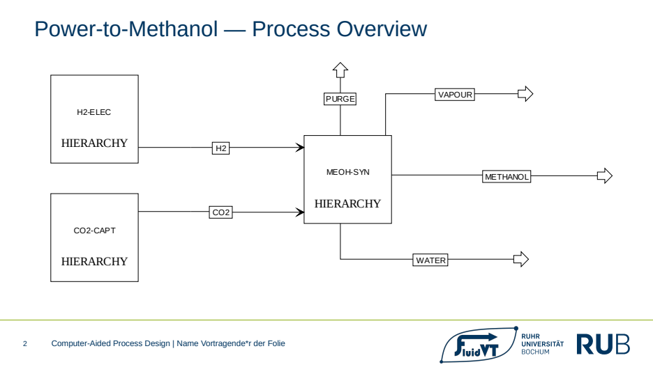
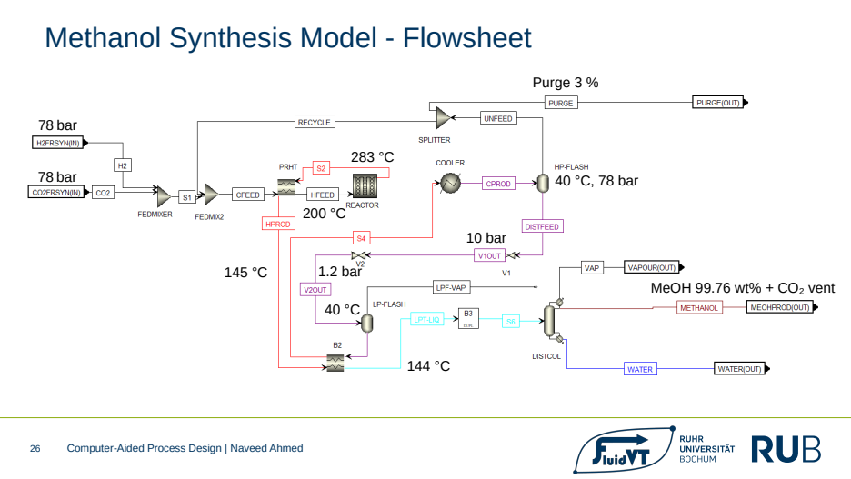
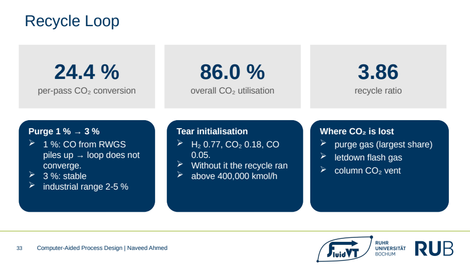
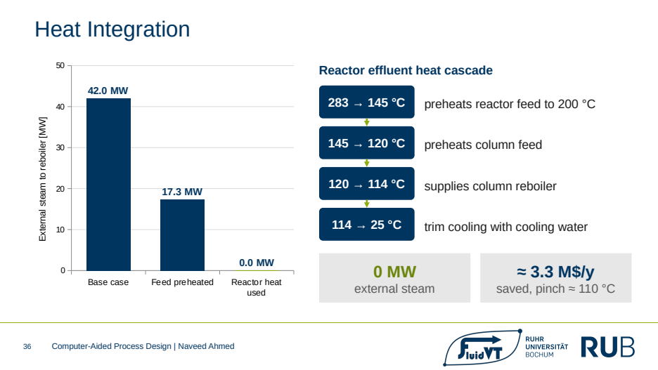
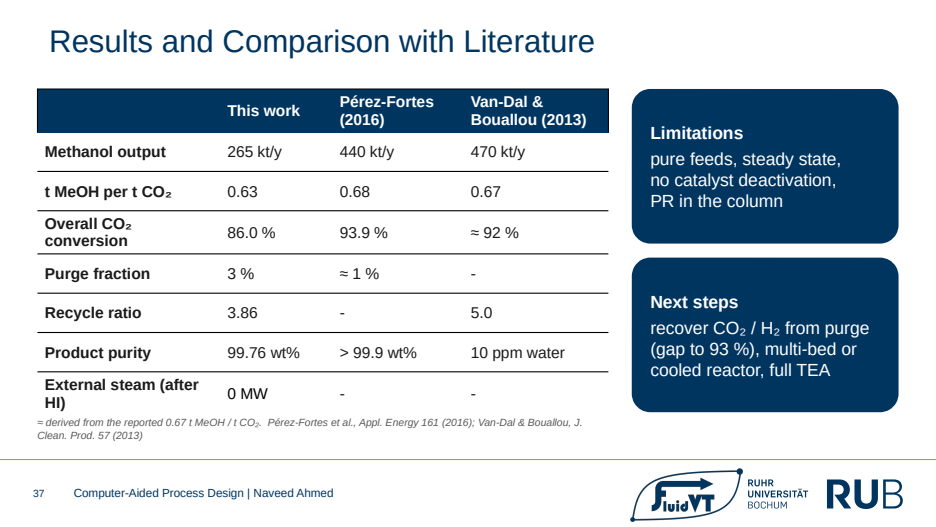

# Green Methanol via Power-to-X

**Process design of a green methanol plant in Aspen Plus — PEM electrolysis, MEA CO₂ capture, methanol synthesis, purification and heat integration**

Ruhr University Bochum · M.Sc. Sustainable Energy Systems and Circular Process Engineering · Computer-Aided Process Design · 2026

📄 **[Full presentation (PDF, 38 slides)](presentation/Green_Methanol_Power_to_X_Presentation.pdf)**

---

## At a glance

| Result | Value |
|---|---|
| Methanol output | **265 kt/year** (≈ 30 t/h) |
| Product purity | **99.76 wt%** |
| PEM electrolyser | 365 MW, H₂ delivered at 30 bar, compressed to 78 bar |
| CO₂ capture (MEA) | **89.7 %** capture from biomass flue gas |
| Overall CO₂ utilisation | **86.0 %** · 0.63 t methanol per t CO₂ |
| Per-pass CO₂ conversion | 24.4 % — inside the published 22–33 % range |
| Heat integration | Reboiler duty cut **56 %** (42 → 17.3 MW), **0 MW external steam** |
| Mass balance closure | relative error 2 × 10⁻⁷ (carbon 2 × 10⁻⁶) |

## What was built

The plant converts renewable electricity and captured CO₂ into methanol in three connected sections, all modelled in **Aspen Plus**:

1. **PEM electrolysis** — stack model at 80 °C with a validated polarisation curve; cathode pressure of 30 bar chosen to cut downstream compression work; hydrogen crossover checked against explosion limits (0.32 mol-% H₂ in O₂ at full load, 12× below the LFL).
2. **CO₂ capture** — MEA absorber / stripper (temperature swing) treating biomass combustion flue gas; regeneration energy optimised to a 51.34 MW operating point at lean loading 0.219, with the reboiler held below the 125 °C MEA degradation limit.
3. **Methanol synthesis and purification** — CO₂ hydrogenation over Cu/ZnO/Al₂O₃ with Bussche–Froment LHHW kinetics in an adiabatic plug-flow reactor (78 bar, 200 °C inlet), recycle loop, two-step letdown and a 20-stage RadFrac column.

## Key engineering decisions

- **Property method:** Peng-Robinson for the high-pressure gas phase (no electrolytes; methanol–water has no azeotrope).
- **Feed ratio and pressure:** stoichiometric H₂ : CO₂ = 3 : 1 — excess hydrogen is expensive because every extra mole comes from the electrolyser; 78 bar captures 89 % of the gain up to 100 bar at a standard vessel rating.
- **Recycle loop:** purge raised from 1 % to 3 % after CO from the reverse water-gas shift accumulated and the loop failed to converge; recycle ratio 3.86.
- **Separation:** a heated degasser lost 68 % of the methanol; a partial vapour-liquid condenser on the column vents CO₂ and loses only 0.7 % — **97× better**.
- **Column design:** sieve trays, 20 stages, feed on stage 14, reflux ratio 3.0; DSTWU failed on dissolved CO₂, so the design moved to a Fenske-Underwood-Gilliland estimate, then RadFrac.

## Heat integration

Pinch analysis in **Aspen Energy Analyzer** (pinch ≈ 110 °C) shows the reactor effluent at 283 °C is the main heat source. Preheating the column feed above its bubble point lets the feed bring its own vapour traffic, cutting reboiler duty by 56 %. The remaining duty is then covered by the partly cooled reactor effluent — **no HP or LP steam is needed**, saving about 3.3 M$ per year.

## Validation

- Every stream checked against reaction stoichiometry; mass, carbon and energy balances closed (mass relative error 2 × 10⁻⁷).
- Reactor at, not past, equilibrium: Q/K = 0.998 at the outlet.
- Results benchmarked against Pérez-Fortes et al. (2016) and Van-Dal & Bouallou (2013).

## Limitations and next steps

Steady state, pure feeds, no catalyst deactivation, Peng-Robinson also used in the low-pressure column. Next steps: recover CO₂ / H₂ from the purge (closing the gap to ≈ 93 % utilisation), a multi-bed or cooled reactor, and a full techno-economic analysis.

## Tools

Aspen Plus · Aspen Energy Analyzer · Excel

---

**Naveed Ahmed** · M.Sc. student, Ruhr University Bochum · [LinkedIn](https://linkedin.com/in/naveedahmed7)

*Course project, Computer-Aided Process Design, Ruhr University Bochum (presented 28 Sep 2026). Co-presenters as listed in the slides: Jonas Bankwitz, Hamide Aveder.*
